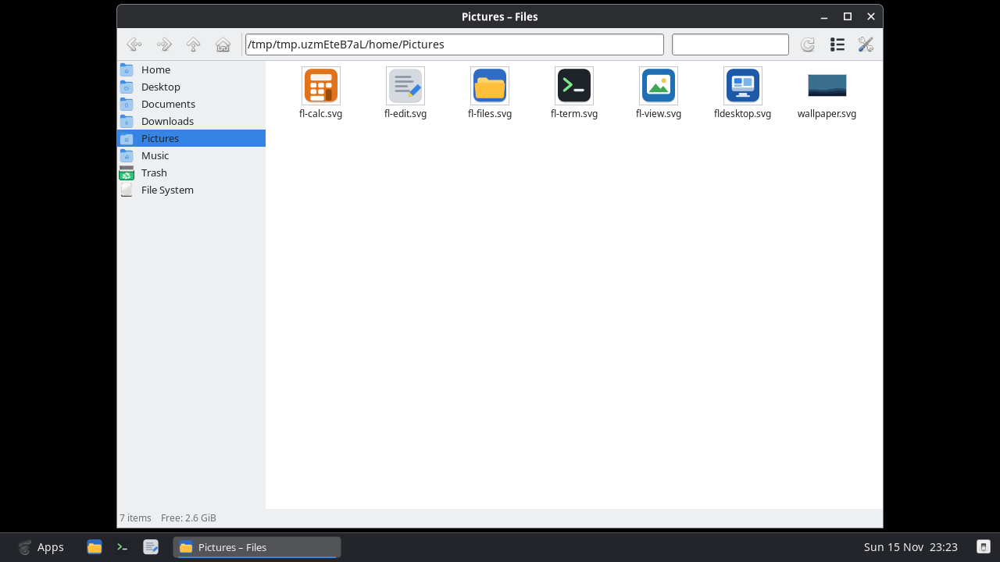
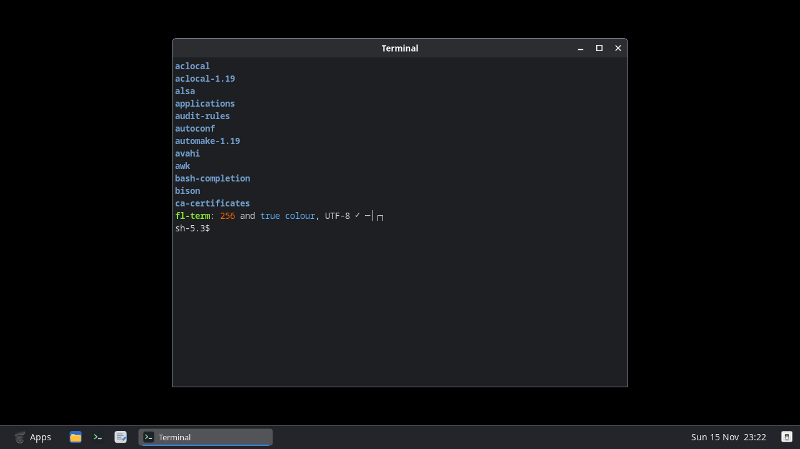
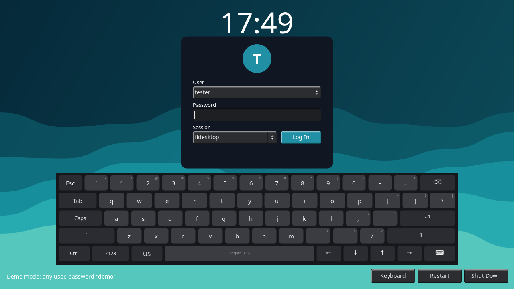
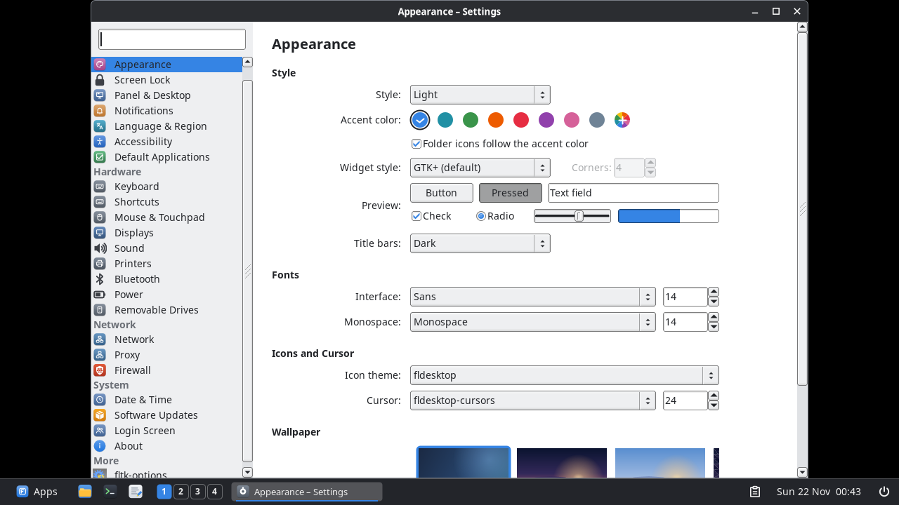
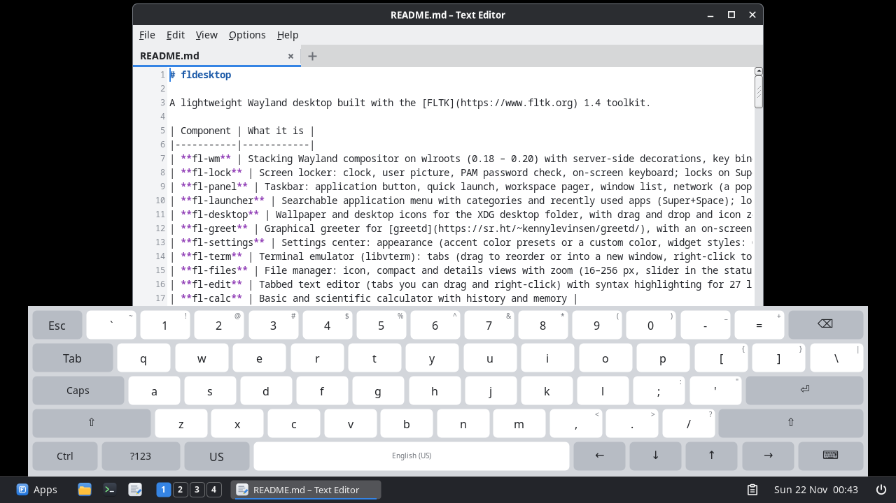
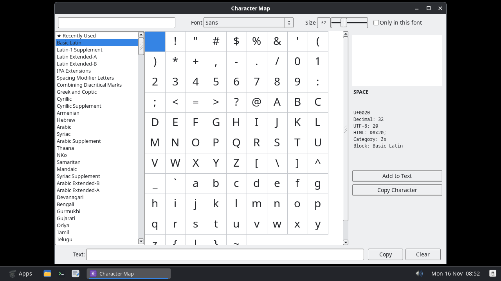
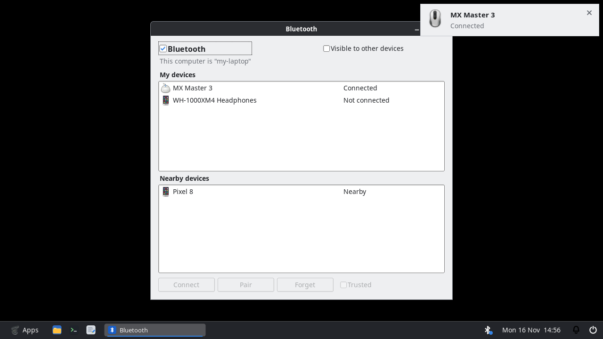
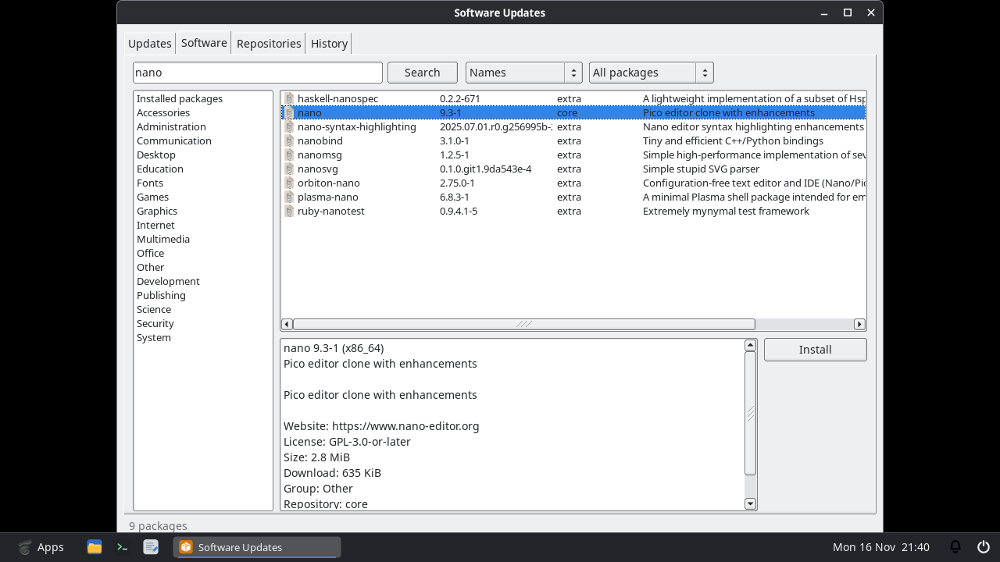

# fldesktop

A lightweight Wayland desktop built with the [FLTK](https://www.fltk.org) 1.4 toolkit.

| Component | What it is |
|-----------|------------|
| **fl-wm** | Stacking Wayland compositor on wlroots (0.18 – 0.20) with server-side decorations, key bindings, Alt+Tab, window snapping and layer-shell |
| **fl-panel** | Taskbar: application button, quick launch, window list, network, volume, Bluetooth, printing, battery, calendar clock, notification history, power menu |
| **fl-launcher** | Searchable application menu with categories and recently used apps (Super+Space) |
| **fl-desktop** | Wallpaper and desktop icons for the XDG desktop folder |
| **fl-greet** | Graphical greeter for [greetd](https://sr.ht/~kennylevinsen/greetd/), with an on-screen keyboard |
| **fl-settings** | Settings center: appearance, panel, notifications, language & region, default apps, keyboard, shortcuts, mouse, displays, sound, printers, Bluetooth, network, firewall, date & time, software updates |
| **fl-term** | Terminal emulator (libvterm): scrollback, true colour, mouse, bracketed paste |
| **fl-files** | File manager: icon/list views, thumbnails, trash, background copy/move, drag and drop |
| **fl-edit** | Tabbed text editor with syntax highlighting, find/replace and auto-indent |
| **fl-calc** | Basic and scientific calculator with history and memory |
| **fl-view** | Image viewer: zoom, rotate, slideshow, animated GIFs |
| **fl-mixer** | PipeWire volume mixer: applications, devices, ports, card profiles, level meters |
| **fl-network** | NetworkManager settings: wired and Wi-Fi devices, saved connections, IPv4/IPv6 editor |
| **fl-polkit-agent** | Password dialog for polkit (administrator actions) |
| **fl-osk** | On-screen keyboard (Wayland virtual-keyboard protocol) |
| **fl-charmap** | Unicode character map with search by name |
| **fl-notifyd** | Notification server (org.freedesktop.Notifications): popups with actions, history and do not disturb in the panel |
| **xdg-desktop-portal-fl** | Portal backend: file chooser, open with, settings, screenshot, access, account, notification and wallpaper portals for Flatpak and portal aware apps |
| **fl-printers** | CUPS printers: driverless or driver setup, defaults, jobs; a panel button while printing and a notification when done |
| **fl-bluetooth** | BlueZ: pairing (with the panel's pairing agent), connecting, trust, battery levels; a panel button with quick connect |
| **fl-packages** | Software updates and packages through PackageKit: updates with changelogs, search, install/remove, sources, history; update notifications |
| **fl-flatpak** | Flatpak app store for Flathub and other sources, with a permissions editor |
| **fl-firewall** | firewalld: zones, services, ports, interfaces, sources, forwarding, panic mode |


| | |
|---|---|
|  |  |
|  |  |
|  |  |
|  |  |
|  |  |
|  |  |
|  |  |
|  |  |
|  | |

Screenshots are made in a headless session by `tools/screenshots.sh`.

All programs share `libfld` (XDG directories, desktop entries, icon themes,
mime types, trash, theme) and read their settings from `~/.config/fldesktop/`.

## Building

Dependencies: CMake ≥ 3.19, a C11/C++17 compiler, FLTK ≥ 1.4 (built with
Wayland support), wlroots 0.18/0.19/0.20, wayland, wayland-protocols,
xkbcommon, libinput, pango/cairo, libdrm, pixman and libvterm. The system
tools also use glib, libpipewire 0.3 (fl-mixer, panel volume, Sound page),
polkit-agent-1 (fl-polkit-agent), libnm (fl-network, panel network, Network
page), fontconfig (fl-charmap), libcups (fl-printers, panel printer button),
packagekit-glib2 (fl-packages), libflatpak and appstream ≥ 1.0 (fl-flatpak);
gio is used for notifications, the portal, Bluetooth and the firewall. Without
one of them the parts that need it are left out.

```sh
# Arch Linux
sudo pacman -S cmake ninja fltk wlroots0.20 libvterm wayland-protocols pango libinput \
  glib2 libpipewire polkit libnm fontconfig libcups packagekit flatpak appstream
# Debian 13 (trixie)
sudo apt install cmake ninja-build pkgconf libfltk1.4-dev libwlroots-0.18-dev libvterm-dev \
  wayland-protocols libwayland-dev libxkbcommon-dev libinput-dev libpango1.0-dev libdrm-dev \
  libglib2.0-dev libpipewire-0.3-dev libpolkit-agent-1-dev libnm-dev libfontconfig-dev \
  libcups2-dev libpackagekit-glib2-dev libflatpak-dev libappstream-dev

cmake -B build -G Ninja
cmake --build build
ctest --test-dir build          # unit tests + a headless compositor smoke test
sudo cmake --install build
```

Each component can be switched off, e.g. `-DFLD_BUILD_WM=OFF` to build only
the FLTK applications for use under another compositor.

### Packages

* **Arch:** `cd packaging/arch && makepkg -si` builds split packages
  (`fldesktop`, `fldesktop-wm`, `fldesktop-shell`, `fldesktop-greeter`,
  `fldesktop-term`, `fldesktop-settings`, `fldesktop-mixer`, …) from the checkout.
* **Debian/Ubuntu:** `cp -r packaging/debian debian && dpkg-buildpackage -b -us -uc`
  produces the same set of `.deb` packages.

CI (`.github/workflows/ci.yml`) builds and tests on Arch (wlroots 0.20) and
Debian trixie (wlroots 0.18). `.github/workflows/repo.yml` builds the packages
(Debian amd64 + arm64, Arch x86_64) and publishes them to the package
repositories below: every push to `main` goes to the *devel* channel, every
`v*` tag to the *stable* channel and to the GitHub release. A release tag
is `v<version>` (the version in `CMakeLists.txt` and `debian/changelog`) or
`v<version>-<n>` for a rebuild of the same version (Debian `<version>+r<n>`,
Arch `pkgrel=<n>`).

### Package repositories

Signed apt and pacman repositories are at <https://yjlion.github.io/fldesktop/>
(key fingerprint `4A49 3D03 7B26 F761 9470  F830 60F9 733B 07BD AA7B`).

```sh
# Debian 13 (trixie); use the suite trixie-devel for builds of main
sudo curl -fsSLo /usr/share/keyrings/fldesktop-archive-keyring.asc \
  https://yjlion.github.io/fldesktop/fldesktop-archive-keyring.asc
echo "deb [signed-by=/usr/share/keyrings/fldesktop-archive-keyring.asc] https://yjlion.github.io/fldesktop/debian trixie main" \
  | sudo tee /etc/apt/sources.list.d/fldesktop.list
sudo apt update && sudo apt install fldesktop fldesktop-greeter fldesktop-archive-keyring
```

```sh
# Arch Linux
curl -fsSLO https://yjlion.github.io/fldesktop/fldesktop-archive-keyring.asc
sudo pacman-key --add fldesktop-archive-keyring.asc
sudo pacman-key --lsign-key 4A493D037B26F7619470F83060F9733B07BDAA7B
# add to /etc/pacman.conf (arch/devel/$arch for builds of main):
#   [fldesktop]
#   Server = https://yjlion.github.io/fldesktop/arch/stable/$arch
sudo pacman -Syu fldesktop fldesktop-greeter fldesktop-keyring
```

The repository tree lives on the `gh-pages` branch; `packaging/repo/publish.sh`
adds packages to it (needs the `FLD_REPO_GPG_KEY` secret in CI).

## Running

* From a display manager: choose the **fldesktop** session (installed to
  `/usr/share/wayland-sessions`).
* From a text console: run `fl-session`.
* Nested inside another Wayland session for testing: run `fl-wm`.
* With greetd: install `fldesktop-greeter`, then replace greetd's default text
  login (`agreety`, which only starts a shell) with fl-greet and restart greetd:

  ```sh
  sudo cp /etc/greetd/config.toml /etc/greetd/config.toml.orig
  sudo cp /usr/share/fldesktop/config.toml /etc/greetd/config.toml
  sudo systemctl enable greetd && sudo systemctl restart greetd
  ```

  The shipped file has the right greeter user and VT for the distribution
  (Arch: `greeter`, VT 1; Debian: `_greetd`, VT 7); elsewhere set
  `command = "cage -s -d -- fl-greet"` and keep the `user` greetd came with.
  `fl-greet --demo` shows the greeter without greetd. Its **Keyboard** button
  shows an on-screen keyboard; `Keyboard=always` in `/etc/fldesktop/greeter.ini`
  shows it from the start (touch-only devices), `Keyboard=never` removes it.

Running uninstalled from the build tree (nested in your current session):

```sh
tools/run-dev.sh            # whole desktop
tools/run-dev.sh -s fl-term # only a terminal
```

### Default shortcuts

| Keys | Action |
|------|--------|
| Super+Space | Application launcher |
| Super+Enter / Super+T | Terminal |
| Super+E | File manager |
| Super+D | Show desktop |
| Super+Q, Alt+F4 | Close window |
| Super+Up / Down | Maximize / minimize |
| Super+Left / Right | Snap to the left / right half |
| F11, Super+F | Fullscreen |
| Alt+Tab, Alt+Shift+Tab | Switch windows |
| Super+drag, Super+right-drag | Move / resize any window |
| Print | Screenshot (needs grim) |
| Super+Shift+R | Reload configuration |
| Ctrl+Alt+Backspace | Quit the session |

Bindings, keyboard layout, pointer settings, outputs and autostart programs
are configured in `~/.config/fldesktop/wm.ini`; an annotated example is
installed as `/usr/share/fldesktop/wm.ini.example`.

## Settings

`fl-settings` (or `fl-settings PAGE`, see `fl-settings --list`) edits the
files below. Changes apply at once where possible: fl-wm reloads `wm.ini`, and
fl-panel and fl-desktop restart themselves when their settings or the theme
change. Other applications use a new theme at their next start. The Displays
page uses the wlr-output-management protocol (so `wlr-randr` and `kanshi` work
too) and reverts a change after 15 seconds unless you keep it. Language &
Region writes `~/.config/fldesktop/environment`, read by `fl-session` at login.

Programs whose desktop entry has `Categories=Settings` (or
`X-FLDesktop-Settings=true`) appear under **More**. A new built-in page is one
C++ file in `apps/fl-settings/pages/` plus one `fld_settings_page()` line in
`apps/fl-settings/CMakeLists.txt`.

The session also starts `fl-polkit-agent` (from `/etc/xdg/autostart`) for
administrator password prompts, `fl-notifyd` for notifications and
`fl-packages --check-updates` to announce updates; fl-panel answers
NetworkManager's Wi-Fi password requests and is the Bluetooth pairing agent.
`fl-autostart` passes `WAYLAND_DISPLAY` to D-Bus activated programs, so
`xdg-desktop-portal-fl` (chosen by `fldesktop-portals.conf`) can show its
dialogs.

## Configuration files

| File | Used by |
|------|---------|
| `~/.config/fldesktop/wm.ini` | compositor: appearance, keys, input, outputs, autostart |
| `~/.config/fldesktop/desktop.ini` | `[Appearance]` theme (light/dark), accent, fonts; `[Desktop]` wallpaper; `[General]` icon theme, terminal |
| `~/.config/fldesktop/panel.ini` | `[Panel] QuickLaunch=`, `KeyboardButton=auto\|always\|never`; `[Clock] Format=` |
| `~/.config/fldesktop/environment` | `LANG`, `LC_*` and other variables for the session |
| `~/.config/fldesktop/osk.ini` | `[Keyboard] Layout=us\|de\|fr`, `Height`, `MaxWidth` |
| `~/.config/fldesktop/charmap.ini` | font, size, recently used characters |
| `~/.config/fldesktop/term.ini` | `[Terminal] ColorScheme=dark\|light`, `FontSize`, `Scrollback` |
| `~/.config/fldesktop/notifications.ini` | `[Notifications] DoNotDisturb`, `Timeout`, `HistorySize`, `Muted` |
| `~/.config/fldesktop/updates.ini` | `[Updates] Check=hourly\|daily\|weekly\|never`, `Notify` |
| `/etc/fldesktop/greeter.ini` | `[Greeter] Background`, `MinUid`, `HideUsers`, `Keyboard=button\|always\|never`, `KeyboardLayout` |

## How the shell works

FLTK cannot create layer-shell surfaces, so the panel, desktop and launcher are
ordinary borderless toplevels. fl-wm recognises them by their app id/title
(`fldesktop.panel`, `fldesktop.desktop`, `fldesktop.launcher`, `fldesktop.osk`,
`fldesktop.panel-popup`, `fldesktop.notification`) **and** checks
that the client executable is the matching program installed next to `fl-wm`,
then pins them to the right layer and position and reserves the panel's space.
The taskbar uses the standard wlr-foreign-toplevel-management protocol, and
third-party layer-shell clients (bars, notification daemons, wallpaper tools)
work as well.

## License

GPL-2.0-or-later, see [COPYING](COPYING). The wlr protocol XML files in
`protocols/` keep their own MIT-style licenses; `data/charmap/Blocks.txt` is
under the Unicode License v3 ([LICENSE.unicode](data/charmap/LICENSE.unicode)).
